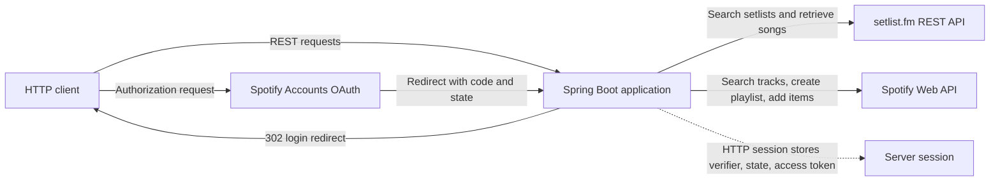

# Setlistify

Setlistify turns concert setlists into Spotify playlists. Its Spring Boot backend integrates setlist.fm and Spotify, using OAuth 2.0 with PKCE to authorize playlist creation from live-performance tracklists.

## How It Works

**Search artist → Select a concert → Retrieve setlist songs → Match tracks on Spotify → Create playlist**

## What It Does

The API exposes these operations:

- `GET /api/v1/setlists/search?artist={name}` returns concert summaries from setlist.fm.
- `GET /api/v1/setlists/{setlistId}/tracks` returns song names from a setlist.
- `POST /api/v1/playlists/generate` takes a setlist ID, artist name, playlist name, and optional public/private choice. It searches Spotify for each song, creates a playlist, adds the first match for each song, and returns the playlist URL and unmatched songs.

The repository has no browser UI; a client must call these endpoints. Spotify login starts at `GET /api/v1/auth/login`.

## Features

- Spotify sign-in using OAuth 2.0 Authorization Code with PKCE.
- Artist-based setlist search through setlist.fm.
- Retrieval of songs from a selected setlist.
- Spotify track search using track and artist query terms.
- Creation of a public or private Spotify playlist and addition of matched tracks.
- A generation response containing the playlist URL, match counts, and unmatched setlist songs.
- Track additions are sent in batches of up to 100 URIs.

## Architecture

Controllers handle HTTP requests, services coordinate the workflow, and `SpotifyClient` and `SetlistFmClient` make outbound HTTP requests with Spring's `RestClient`. Response and request data is represented by Java records in DTO classes.



## Authentication

When `/api/v1/auth/login` is called, the server generates a random **code verifier**, derives a SHA-256 **code challenge**, and generates a random **state** value. It saves the verifier and state in the HTTP session, then redirects the client to Spotify with the challenge and state.

After authorization, Spotify redirects to `/api/v1/auth/callback` with a code and state. The server checks the returned state against the value in the session, then exchanges the code and saved verifier at Spotify's token endpoint. The verifier proves possession of the secret corresponding to the earlier challenge. The access token is then stored in the session and used for playlist requests.

The implementation stores the access token in the HTTP session, but does not refresh it or handle expiry, and it has no logout endpoint. The configured redirect URI is `http://127.0.0.1:8080/api/v1/auth/callback` for local development.

## Engineering Decisions

- Spotify and setlist.fm HTTP calls are isolated in separate client classes; service classes handle the multi-call workflow.
- API payloads use Java record DTOs, including nested records for Spotify search results and setlist.fm concert data.
- The PKCE verifier and OAuth state live in the HTTP session across the redirect. The access token is kept there for subsequent requests, so authentication depends on session continuity; the application is not stateless.
- Track searches use `track:{song} artist:{artist}` and request one result. The service takes that first result when available and reports songs with no result as unmatched.
- Spotify searches currently run sequentially, one request per setlist song. This keeps the workflow straightforward, but playlist generation time grows with the number of songs and Spotify's response times; parallel lookups would need to account for API rate limits.
- The service adds Spotify URIs through `POST /playlists/{playlist_id}/items`, in batches of at most 100.

## Tech Stack

- Java 21
- Spring Boot 4.1.0 and Spring Web MVC (`RestClient` for outbound HTTP)
- Maven and Maven Wrapper
- Spotify Accounts service and Spotify Web API
- setlist.fm REST API

## Running Locally

Prerequisites: Java 21 and a Spotify developer application, plus a setlist.fm API key.

1. Configure the Spotify application redirect URI as `http://127.0.0.1:8080/api/v1/auth/callback`.
2. Set the required environment variables in the shell where the application will run:

   ```sh
   export SPOTIFY_CLIENT_ID="your-spotify-client-id"
   export SETLIST_FM_KEY="your-setlist-fm-api-key"
   ```

3. Start the server:

   ```sh
   ./mvnw spring-boot:run
   ```

The application uses Spring Boot's default local port, `8080`. Start the OAuth flow at `http://127.0.0.1:8080/api/v1/auth/login`; the other routes are JSON endpoints under `/api/v1`. Keep credentials out of source control. Although `.env` is ignored by Git, the application does not load it; set the variables in the process environment or use a separate environment loader.

## Testing

The test suite currently contains one Spring Boot context-load test. There are no dedicated tests for OAuth callback validation, external API clients, setlist parsing, track matching, or playlist generation.

## Current Limitations

- The project provides a REST API only; there is no user-facing web interface.
- Spotify access tokens are stored in the HTTP session, but refresh-token and expired-session handling are not implemented.
- Matching uses only Spotify's first search result, with no confidence check or manual review.
- Production deployment and API-specific error handling are not implemented.

## Roadmap

Planned work, not implemented yet:

### Near Term

- Expand automated unit and integration testing.
- Configure outbound HTTP timeouts and handle Spotify `429` responses using `Retry-After` before considering concurrent track lookups.
- Add GitHub Actions CI.
- Build a React frontend.
- Containerize and deploy the application with a production HTTPS redirect URI.

### Later

- Benchmark repeated setlist retrieval and evaluate Redis caching, subject to API terms.
- Explore screenshot or image input for track extraction.
- Improve Spotify track matching beyond first-result selection.
- Add persistent user and social features if the product expands in that direction.

## Engineering Highlights

Setlistify demonstrates third-party API integration, OAuth 2.0 with PKCE, session-backed authentication, typed Java records for nested JSON responses, layered Spring architecture, and orchestration of multi-step workflows across external services.
