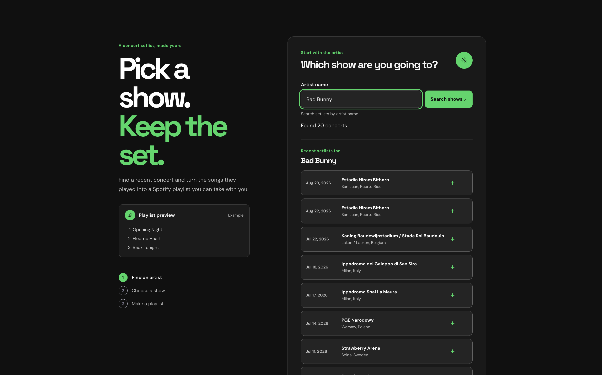
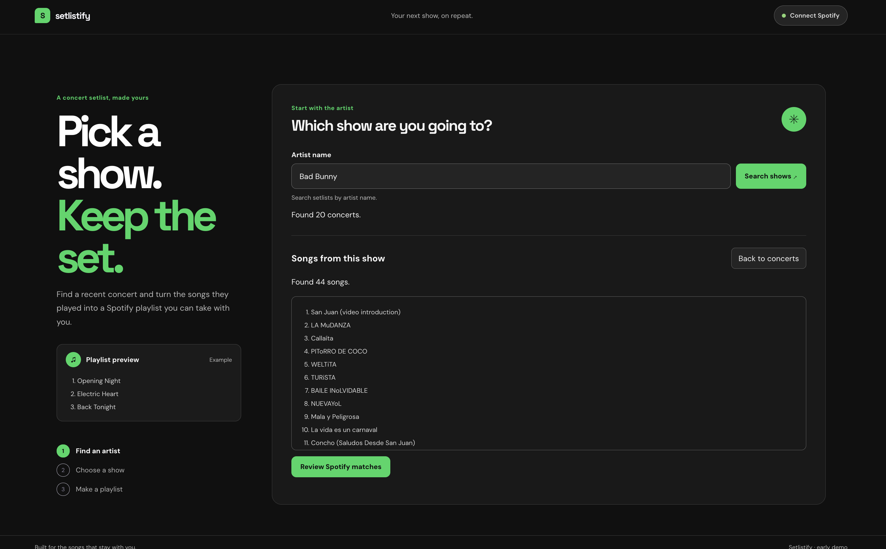
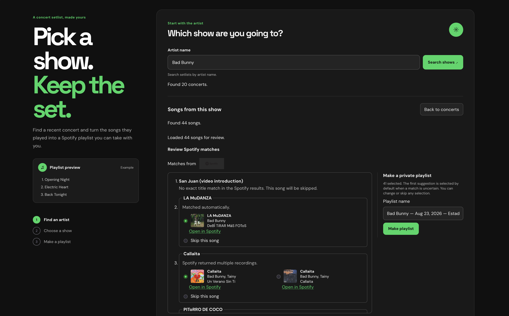
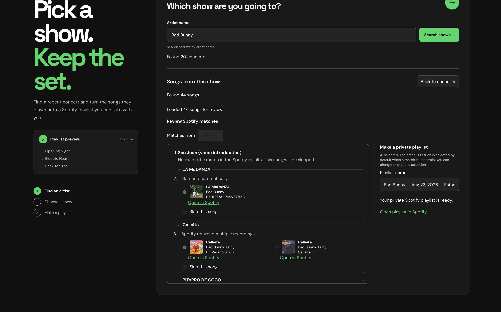
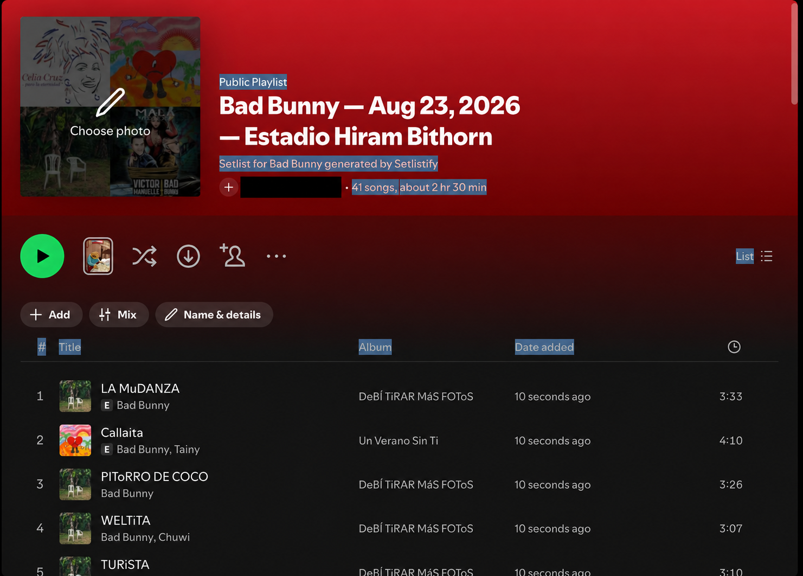
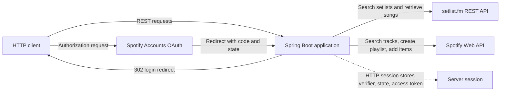

# Setlistify

[](https://github.com/pilkeyy/setlistify/actions/workflows/ci.yml)

Setlistify turns concert setlists into Spotify playlists. Its Spring Boot backend integrates setlist.fm and Spotify, using OAuth 2.0 with PKCE to authorize playlist creation from live-performance tracklists.

## Demo

This walkthrough shows the React app searching for a Bad Bunny concert, reviewing recordings, and displaying the playlist result. It uses sample API responses, including a simulated Spotify save, so it can be viewed without signing in.


### Screenshots from a live run

**1. Search for a concert**



**2. View the concert setlist**



**3. Review Spotify recordings**



**4. See the playlist confirmation**



**5. Open the 41-track playlist in Spotify**



## How It Works

**Search artist → Select a concert → Retrieve setlist songs → Match tracks on Spotify → Create playlist**

## What It Does

The API exposes these operations:

- `GET /api/v1/setlists/search?artist={name}` returns concert summaries from setlist.fm.
- `GET /api/v1/setlists/{setlistId}/tracks` returns song names from a setlist.
- `POST /api/v1/playlist-previews` takes `{"setlistId":"…"}` and returns `200` with a review ID, the concert artist, and songs in setlist order. Each row has a one-based `songId`, title, match status, reason, and up to three candidates, each with at most one artwork image sized for display. The server keeps the allowed candidate URIs for one active review in the Spotify session; the review ID is valid for 30 minutes. Preview only reads from Spotify. Errors: `409` if a newer preview replaced this one, `504` if matching exceeds 15 seconds, `503` with `Retry-After` while Spotify is rate limiting (see [Performance and Rate Limits](#performance-and-rate-limits)).
- `POST /api/v1/playlists` takes `reviewId`, `playlistName`, and `selections` containing `{songId, trackUri}` pairs. It validates the selected candidate for each song, skips omitted rows, and creates a private Spotify playlist in concert order. It returns `201` with the playlist link when Spotify confirms all writes. If adding tracks fails after creation, the error response includes a link to the playlist so the user can inspect it.
- `POST /api/v1/playlists/generate` takes a setlist ID, artist name, playlist name, and optional public/private choice. It classifies Spotify search results, creates a playlist only when at least one track is confirmed, and returns the playlist URL plus songs that were unmatched or need review. If no track is confirmed, it returns `422` without creating a playlist.

In React, users search for an artist, choose a concert, sign in to Spotify, review the matches, and choose **Make playlist** to save the selected tracks.

## Features

- Spotify sign-in using OAuth 2.0 Authorization Code with PKCE, with server-side token refresh.
- Artist-based concert search and setlist retrieval through setlist.fm.
- Track matching that auto-selects only an unambiguous match (exact normalized title plus a credited artist) and sends multiple recordings, title variants (such as “(feat. …)” or “- Remix”), and artist mismatches to review.
- A review step where the user keeps, changes, or skips each song before anything is written to Spotify.
- Private playlist creation in concert order, with tracks added in batches of up to 100 URIs.
- Parallel, rate-limit-aware matching with caching (see [Performance and Rate Limits](#performance-and-rate-limits)).

## Architecture

Controllers handle HTTP requests, services coordinate the workflow, and `SpotifyClient` and `SetlistFmClient` make outbound HTTP requests with Spring's `RestClient`. Response and request data is represented by Java records in DTO classes.



## Authentication

When `/api/v1/auth/login` is called, the server generates a random **code verifier**, derives a SHA-256 **code challenge**, and generates a random **state** value. It saves the verifier and state in the HTTP session, then redirects the client to Spotify with the challenge and state.

After authorization, Spotify redirects to `/api/v1/auth/callback` with a code and state. The server checks the returned state against the value in the session, then exchanges the code and saved verifier at Spotify's token endpoint. The verifier proves possession of the secret corresponding to the earlier challenge. The access token is then stored in the session and used for playlist requests.

The backend stores the tokens and expiry in the HTTP session. It refreshes expired access tokens before playlist requests when a refresh token is available. The frontend prompts the user to reconnect when the API returns `401`. The Spotify callback redirects to the frontend with a sign-in result. The browser does not receive the tokens.

## Engineering Decisions

- Spotify and setlist.fm HTTP calls are isolated in separate client classes; service classes handle the multi-call workflow.
- API payloads use Java record DTOs, including nested records for Spotify search results and setlist.fm concert data.
- The PKCE verifier and OAuth state live in the HTTP session across the redirect. The access token is kept there for subsequent requests, so authentication depends on session continuity; the application is not stateless.
- Track searches start with `track:{song} artist:{artist}` and request five results. A single exact normalized title match with the artist anywhere in the track credits is eligible for automatic selection. A credited track with a matching base title and a recognized version suffix, such as “(Bonus)” or “- Remix,” is offered for review. If neither is found, the matcher tries one title-only search before reporting an artist mismatch or an unmatched song. Multiple exact title-and-artist recordings also go to review.
- Playlist creation happens after matching. If there are no confirmed tracks, no Spotify playlist is created; Spotify search or playlist-write errors are still upstream failures rather than unmatched songs.
- Preview and confirm are separate requests. The server stores the candidate URIs it offered and accepts only those on confirm, rebuilding concert order from its own rows; it consumes the review before writing so a repeated submission cannot create a second playlist.
- Each preview registers itself as the session's latest before any blocking work (token refresh, matching). Only the latest may save its review, and a replaced preview stops its queued Spotify searches.
- Spotify searches run concurrently on Java 21 virtual threads behind one app-wide `Semaphore`, because Spotify rate-limits the whole app rather than each user. Results are consumed as they finish and reassembled in setlist order.
- The service adds Spotify URIs through `POST /playlists/{playlist_id}/items`, in batches of at most 100.

## Performance and Rate Limits

Matching was the slow step: originally one blocking Spotify search per song, one after another, after fetching the setlist from setlist.fm a second time. Measured from the per-preview timing log on real setlists:

| Version | 38 songs | 50 songs |
| --- | --- | --- |
| Sequential searches (sum of search times) | 9.95 s | 14.1 s |
| Parallel, 6 searches in flight | 1.76 s | 2.70 s |
| Parallel, 3 searches in flight, first match | TODO(numbers) | TODO(numbers) |
| Repeat match of the same concert (cached) | TODO(numbers) | TODO(numbers) |

How it stays within limits:

- **Fewer calls first.** The setlist is cached (15 minutes) with one shared in-flight fetch per setlist, each distinct title is searched once per preview, and search results are cached for an hour.
- **Bounded concurrency.** At most three searches are in flight across the app. Six was faster, but bursts of about 20 requests per second earned a two-hour `429` from Spotify in development mode.
- **Timeouts and a deadline.** 3-second connect and 5-second read timeouts on every outbound call, and a 15-second limit for a whole preview.
- **Cooldown.** After a Spotify `429`, the app stops searching until `Retry-After` passes and returns `503` with `Retry-After`, so the UI waits instead of retrying. Cached concerts still preview during a cooldown.
- **Error precedence.** An authorization failure (`401`/`403`) wins over an active cooldown, so the reconnect prompt is never hidden.

## Tech Stack

- Java 21 (virtual threads)
- Spring Boot 4.1.0 and Spring Web MVC (`RestClient` for outbound HTTP)
- React 19 and Vite
- JUnit 5, Mockito, MockMvc, and `MockRestServiceServer`
- GitHub Actions CI
- Maven and Maven Wrapper
- Spotify Accounts service and Spotify Web API
- setlist.fm REST API

## Running Locally

Prerequisites: Java 21 and a Spotify developer application, plus a setlist.fm API key.

1. Configure the Spotify application redirect URI as `http://127.0.0.1:8080/api/v1/auth/callback`.
2. Set the required environment variables in the shell where the application will run:

   ```sh
   export SPOTIFY_CLIENT_ID="your-spotify-client-id"
   export SETLIST_FM_KEY="your-setlist-fm-api-key"
   ```

3. Start the server:

   ```sh
   ./mvnw spring-boot:run
   ```

4. With Node.js installed, start the frontend in a second terminal:

   ```sh
   cd frontend
   npm ci
   npm run dev
   ```

5. Open `http://127.0.0.1:5173`, pick a concert, and use **Connect Spotify** and **Review Spotify matches**. Use `127.0.0.1` for both servers so they share the browser's session cookie. Vite proxies `/api` to Spring Boot on port `8080`. The callback returns to `http://127.0.0.1:5173` by default, controlled by the Spring property `app.frontend-url`.

Keep credentials out of source control. Although `.env` is ignored by Git, the application does not load it; set the variables in the process environment or use a separate environment loader.

## Testing

GitHub Actions runs `./mvnw -B verify` and the frontend production build on every pull request and every push to `main`. Tests use mocks and never call Spotify or setlist.fm, so CI needs only placeholder API keys.

The backend suite covers the matching rules (normalization, title variants, review outcomes), HTTP responses and error mapping, the preview/confirm flow and its allowlist, and the concurrency behavior: setlist order with bounded searches, rate-limit cooldowns with and without `Retry-After`, deadlines, overlapping previews and the token-refresh race, caching, and single-flight setlist fetches. Run it locally with:

```sh
SETLIST_FM_KEY=test SPOTIFY_CLIENT_ID=test ./mvnw test
```

The browser login and review flow has no automated coverage yet.

## Current Limitations

- **Spotify development mode.** Spotify limits development-mode apps to a small allowlist of users (five as of 2026), and extended access is aimed at established organizations. Setlistify deliberately stays a personal project in development mode; see the roadmap for how it would scale.
- **setlist.fm quota.** One API key serves every user, with a per-second and a daily request limit. Artist searches are not cached yet.
- **Single instance.** Sessions, caches, and the rate-limit cooldown live in memory. Restarting clears them, and a second instance would not share them.
- **Shared search cache.** Cached Spotify results are shared across users, although Spotify results can depend on the user's market.
- Each Spotify session has one active review. An interrupted or partial Spotify write has no automatic retry.
- The app has no logout endpoint.
- The project is configured for local development.

## Roadmap

Planned work, not implemented yet:

### Near Term

- Cache setlist.fm artist searches and space setlist.fm calls to stay within its per-second limit.
- Add frontend tests for the review flow.
- Add Dependabot updates for GitHub Actions, Maven, and npm.
- Retire the legacy `POST /api/v1/playlists/generate` endpoint after confirming it has no consumers.

### Scaling beyond development mode

- Search with an app-level token (client credentials) and create playlists in a shared Setlistify account, or export a track list, so users do not need to be allowlisted.
- Move sessions, caches, and the rate-limit cooldown to Redis so several instances share them, and replace the per-instance semaphore with a shared rate limiter.
- Request a higher setlist.fm quota.

### Later

- Explore screenshot or image input for track extraction.
- Add persistent user and social features if the product expands in that direction.

## Engineering Highlights

Setlistify demonstrates third-party API integration with OAuth 2.0 and PKCE, evidence-based track matching with a human review step, a preview/confirm API that never trusts client-supplied track choices, bounded concurrency on Java 21 virtual threads, rate-limit and timeout handling for external services, measured performance work, and a test suite (run in CI) that covers race conditions as well as business rules.
