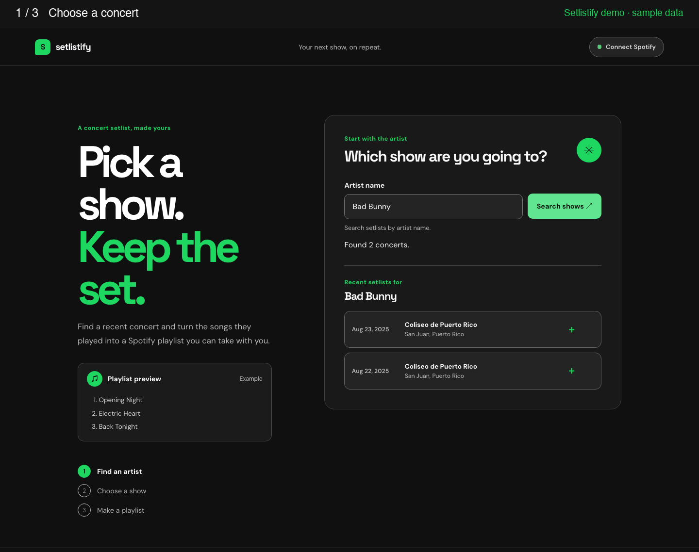
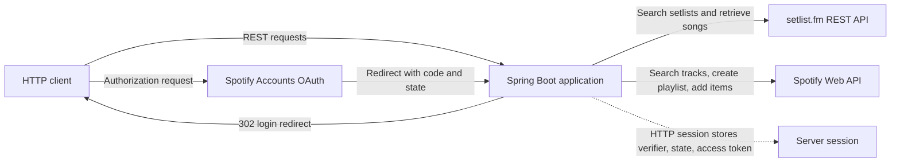

# Setlistify

Setlistify turns concert setlists into Spotify playlists. Its Spring Boot backend integrates setlist.fm and Spotify, using OAuth 2.0 with PKCE to authorize playlist creation from live-performance tracklists.

## Demo

This walkthrough shows the React app searching for a Bad Bunny concert, reviewing recordings, and displaying the playlist result. It uses sample API responses, including a simulated Spotify save, so it can be viewed without signing in.



### Screenshots from a live run

**1. Search for a concert**


**2. View the concert setlist**


**3. Review Spotify recordings**


**4. See the playlist confirmation**


**5. Open the 41-track playlist in Spotify**


## How It Works

**Search artist → Select a concert → Retrieve setlist songs → Match tracks on Spotify → Create playlist**

## What It Does

The API exposes these operations:

- `GET /api/v1/setlists/search?artist={name}` returns concert summaries from setlist.fm.
- `GET /api/v1/setlists/{setlistId}/tracks` returns song names from a setlist.
- `POST /api/v1/playlist-previews` takes `{"setlistId":"…"}` and returns `200` with a review ID, the concert artist, and songs in setlist order. Each row has a one-based `songId`, title, match status, reason, and up to three candidates, each with at most one artwork image sized for display. The server keeps the allowed candidate URIs for one active review in the Spotify session. The review ID is valid for 30 minutes. Preview only reads from Spotify. Each distinct title is searched once, with at most three searches in flight across the app, and search results are cached for an hour so re-matching a concert makes no new Spotify calls; matching that exceeds 15 seconds returns `504`, and after a Spotify `429` new searches fail fast, and any preview failure during that cooldown returns `503` with `Retry-After`.
- `POST /api/v1/playlists` takes `reviewId`, `playlistName`, and `selections` containing `{songId, trackUri}` pairs. It validates the selected candidate for each song, skips omitted rows, and creates a private Spotify playlist in concert order. It returns `201` with the playlist link when Spotify confirms all writes. If adding tracks fails after creation, the error response includes a link to the playlist so the user can inspect it.
- `POST /api/v1/playlists/generate` takes a setlist ID, artist name, playlist name, and optional public/private choice. It classifies Spotify search results, creates a playlist only when at least one track is confirmed, and returns the playlist URL plus songs that were unmatched or need review. If no track is confirmed, it returns `422` without creating a playlist.

In React, users search for an artist, choose a concert, sign in to Spotify, review the matches, and choose **Make playlist** to save the selected tracks.

## Features

- Spotify sign-in using OAuth 2.0 Authorization Code with PKCE.
- Artist-based setlist search through setlist.fm.
- Retrieval of songs from a selected setlist.
- Spotify track search using track and artist query terms.
- Creation of a public or private Spotify playlist and addition of matched tracks.
- A generation response containing the playlist URL, match counts, and unmatched setlist songs.
- Track additions are sent in batches of up to 100 URIs.

## Architecture

Controllers handle HTTP requests, services coordinate the workflow, and `SpotifyClient` and `SetlistFmClient` make outbound HTTP requests with Spring's `RestClient`. Response and request data is represented by Java records in DTO classes.



## Authentication

When `/api/v1/auth/login` is called, the server generates a random **code verifier**, derives a SHA-256 **code challenge**, and generates a random **state** value. It saves the verifier and state in the HTTP session, then redirects the client to Spotify with the challenge and state.

After authorization, Spotify redirects to `/api/v1/auth/callback` with a code and state. The server checks the returned state against the value in the session, then exchanges the code and saved verifier at Spotify's token endpoint. The verifier proves possession of the secret corresponding to the earlier challenge. The access token is then stored in the session and used for playlist requests.

The backend stores the tokens and expiry in the HTTP session. It refreshes expired access tokens before playlist requests when a refresh token is available. The frontend prompts the user to reconnect when the API returns `401`. The Spotify callback redirects to the frontend with a sign-in result. The browser does not receive the tokens.

## Engineering Decisions

- Spotify and setlist.fm HTTP calls are isolated in separate client classes; service classes handle the multi-call workflow.
- API payloads use Java record DTOs, including nested records for Spotify search results and setlist.fm concert data.
- The PKCE verifier and OAuth state live in the HTTP session across the redirect. The access token is kept there for subsequent requests, so authentication depends on session continuity; the application is not stateless.
- Track searches start with `track:{song} artist:{artist}` and request five results. A single exact normalized title match with the artist anywhere in the track credits is eligible for automatic selection. A credited track with a matching base title and a recognized version suffix, such as “(Bonus)” or “- Remix,” is offered for review. If neither is found, the matcher tries one title-only search before reporting an artist mismatch or an unmatched song. Multiple exact title-and-artist recordings also go to review.
- Playlist creation happens after matching. If there are no confirmed tracks, no Spotify playlist is created; Spotify search or playlist-write errors are still upstream failures rather than unmatched songs.
- Spotify searches run sequentially, with up to two requests per song. Playlist generation time grows with the number of songs and Spotify's response times; parallel lookups would need to account for API rate limits.
- The service adds Spotify URIs through `POST /playlists/{playlist_id}/items`, in batches of at most 100.

## Tech Stack

- Java 21
- Spring Boot 4.1.0 and Spring Web MVC (`RestClient` for outbound HTTP)
- Maven and Maven Wrapper
- Spotify Accounts service and Spotify Web API
- setlist.fm REST API

## Running Locally

Prerequisites: Java 21 and a Spotify developer application, plus a setlist.fm API key.

1. Configure the Spotify application redirect URI as `http://127.0.0.1:8080/api/v1/auth/callback`.
2. Set the required environment variables in the shell where the application will run:

   ```sh
   export SPOTIFY_CLIENT_ID="your-spotify-client-id"
   export SETLIST_FM_KEY="your-setlist-fm-api-key"
   ```

3. Start the server:

   ```sh
   ./mvnw spring-boot:run
   ```

4. With Node.js installed, start the frontend in a second terminal:

   ```sh
   cd frontend
   npm ci
   npm run dev
   ```

5. Open `http://127.0.0.1:5173`, pick a concert, and use **Connect Spotify** and **Review Spotify matches**. Use `127.0.0.1` for both servers so they share the browser's session cookie. Vite proxies `/api` to Spring Boot on port `8080`. The callback returns to `http://127.0.0.1:5173` by default, controlled by the Spring property `app.frontend-url`.

Keep credentials out of source control. Although `.env` is ignored by Git, the application does not load it; set the variables in the process environment or use a separate environment loader.

## Testing

The backend has a Spring Boot context test and focused tests for playlist HTTP responses, API errors, Spotify client behavior, and preview ordering and artwork. The browser login and review flow has no automated coverage yet.

## Current Limitations

- Each Spotify session has one active review. A new preview replaces it, and a valid creation attempt consumes it. An interrupted or partial Spotify write has no automatic retry.
- The app has no logout endpoint.
- Spotify searches run sequentially, so preview time increases with setlist length.
- The project is configured for local development.

## Roadmap

Planned work, not implemented yet:

### Near Term

- Expand automated unit and integration testing.
- Configure outbound HTTP timeouts and handle Spotify `429` responses using `Retry-After` before considering concurrent track lookups.
- Add GitHub Actions CI.
- Containerize and deploy the application with a production HTTPS redirect URI.

### Later

- Benchmark repeated setlist retrieval and evaluate Redis caching, subject to API terms.
- Explore screenshot or image input for track extraction.
- Improve Spotify track matching beyond first-result selection.
- Add persistent user and social features if the product expands in that direction.

## Engineering Highlights

Setlistify demonstrates third-party API integration, OAuth 2.0 with PKCE, session-backed authentication, typed Java records for nested JSON responses, layered Spring architecture, and orchestration of multi-step workflows across external services.
